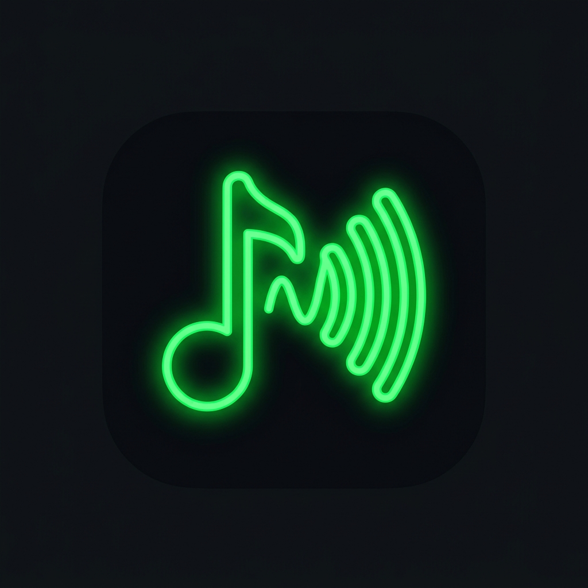

# Myato-Player 2.1 Pro

<p align="center">
  
</p>

<p align="center">
  <strong>Reprodutor e Gerenciador Profissional de Músicas para Android</strong><br />
  Recursos Avançados Inspirados no Musicolet • Tema Dark Pitch Black & Neon Green • Motor de Áudio Media3 ExoPlayer • 100% Offline e Livre de Rastreamento.
</p>

<p align="center">
  <a href="https://github.com/myatodevolper-lab/Myato-Player/releases/latest"></a>
  <a href="https://github.com/myatodevolper-lab/Myato-Player"></a>
  
  
</p>

---

## 📥 DOWNLOAD DO MYATO-PLAYER

Baixe a versão mais recente e estável do Myato-Player diretamente pelo botão abaixo:

<p align="center">
  <a href="https://github.com/myatodevolper-lab/Myato-Player/releases/latest">
    
  </a>
</p>

> **Link Direto de Download:** [https://github.com/myatodevolper-lab/Myato-Player/releases/latest](https://github.com/myatodevolper-lab/Myato-Player/releases/latest)  
> **Nome do Arquivo de Lançamento:** `Myato-Player-v2.1.apk`  
> **Compatibilidade:** Android 7.0 (API 24) até Android 15/16 (API 36).

---

## 📸 Capturas de Tela do Aplicativo

A documentação visual completa encontra-se catalogada em [`docs/screenshots/`](docs/screenshots/):

| Tela Inicial & Hero Player | Reprodutor & Toolbelt Musicolet | Letras Sincronizadas (.LRC) |
|:---:|:---:|:---:|
| Acesso rápido a 20 Filas e Stats | Repetição A-B, Pitch & Velocidade | Destaque verso ativo e rolagem |

| Gerenciador de 20 Filas | Editor Completo de Tags ID3 | Estatísticas Musicais & CSV |
|:---:|:---:|:---:|
| Troca sem perda de estado | Edição individual e em lote | Períodos: Hoje, 7d, 30d, Ano |

---

## 🚀 Novidades da Versão 2.1 (Inspiradas no Musicolet)

O **Myato-Player 2.1** foi totalmente aprimorado para incorporar o conjunto completo de ferramentas e conveniências avançadas consagradas no Musicolet:

### 1. 🗂️ Até 20 Filas de Reprodução Independentes
* Crie e mantenha até 20 filas separadas (ex.: "Treino", "Estudos", "Viagem", "Rock Clássico").
* Alterne entre filas instantaneamente sem perder a faixa atual, o tempo exato em milissegundos ou o modo shuffle/repetição de cada uma.
* Opções completas: **Duplicar fila**, **Renomear fila**, **Excluir fila** e **Salvar fila como playlist permanente**.
* Criação direta de novas filas a partir de Álbuns, Artistas ou Pastas.

### 2. 🏷️ Editor Avançado de Tags ID3 (Individual e em Lote)
* Suporte à edição completa de metadados:
  * Título, Artista, Artista do Álbum, Álbum, Gênero, Ano, Número da Faixa, Número do Disco, Compositor, Comentários e Letras embutidas.
* **Edição em Lote**: Altere simultaneamente Artista, Álbum e Gênero de dezenas de músicas selecionadas via sistema de seleção múltipla.

### 3. 🎤 Letras Sincronizadas (.LRC) & Repetição A-B
* Suporte nativo a arquivos de letras com timestamps no padrão `[mm:ss.xx]`.
* Rolagem suave e sincronizada destacando o verso que está tocando no momento.
* Toque em qualquer linha da letra para saltar instantaneamente a reprodução para aquele trecho.
* **Editor Integrado de Letras**: Insira novas linhas ou carimbe o tempo atual (`[Agora]`) para sincronizar suas próprias músicas.
* **Repetição A-B**: Marque o ponto inicial (A) e final (B) com precisão para repetição contínua de trechos musicais, solos ou frases em idiomas.

### 4. 📌 Marcadores & Anotações de Áudio
* Salve marcadores com carimbo de tempo preciso e notas de texto descritivas.
* Lista de marcadores por música com salto imediato para o momento desejado com um único toque.

### 5. 🎚️ Equalizador com Perfis por Dispositivo & Balanço de Canais
* 5 bandas paramétricas (-12dB a +12dB), Bass Boost (Reforço de Graves) e Virtualizador Surround 3D.
* **Perfis Automáticos**: Configurações independentes para:
  1. *Alto-falante Interno*
  2. *Fone de Ouvido com Fio*
  3. *Dispositivos Bluetooth*
  4. *Saídas USB / DAC Externo*
* Detecção automática da troca de dispositivo e aplicação imediata do perfil correspondente.
* Controle de **Balanço Estéreo** (Esquerda/Direita) de 0% a 100%.

### 6. ⚡ Ajuste Fino de Velocidade e Tom (Pitch)
* Controle de velocidade de reprodução variável de **0.25x até 3.0x**.
* Ajuste independente de tom musical de **0.5x até 2.0x**.
* Processamento limpo sem artefatos ou distorções no motor ExoPlayer.

### 7. 📊 Estatísticas Musicais Detalhadas & Exportação CSV
* Métricas completas de tempo total escutado (horas e minutos), contagem de reproduções, histórico e favoritos.
* Filtros por período: **Hoje**, **Últimos 7 dias**, **Últimos 30 dias**, **Este Mês**, **Este Ano** e **Todo o Período**.
* Listagem de Top Músicas e Top Artistas.
* Exportação dos dados estatísticos em arquivo tabular **CSV** com opção de compartilhamento ou cópia.
* Opção de limpar o histórico individual de qualquer faixa.

### 8. 📁 Navegação Avançada por Pastas
* Dois modos de visualização:
  * **Modo Linear**: Todas as pastas contendo áudio em uma lista prática.
  * **Modo Hierárquico**: Árvore de diretórios no estilo gerenciador de arquivos.
* Ações diretas: Reproduzir pasta inteira, adicionar pasta à fila e buscar dentro de pastas.

### 9. ⏰ Timer de Sono (Sleep Timer) Avançado
* Minutos personalizáveis com contagem regressiva em tempo real.
* Opção de **"Parar após a faixa atual"** para não cortar músicas no meio.
* **Fade-out Gradual**: O volume diminui suavemente nos últimos 30 segundos antes de pausar a reprodução.

### 10. 📱 Widget de Tela Inicial & Notificação MediaSession
* Widget nativo para a tela inicial do celular com capa, título, artista, botões Anterior, Play/Pause, Próxima e atalho para o app.
* Notificação persistente de segundo plano via Media3 `MediaSessionService`.

### 11. 💾 Backup & Restauração JSON Expandido
* Backup completo de: Filas de reprodução, Marcadores, Playlists personalizadas e Músicas favoritas.
* Restauração rápida e compatível entre dispositivos.

---

## 🛠️ Tecnologias Utilizadas

* **Linguagem**: Kotlin 2.2.10
* **Interface**: Jetpack Compose com Material Design 3 (M3)
* **Motor de Áudio**: AndroidX Media3 ExoPlayer 1.5.1 + Media3 Session
* **Banco de Dados Local**: AndroidX Room 2.7.0 (SQLite Local)
* **Persistência Reativa**: Kotlin Coroutines & StateFlow
* **Carregamento de Imagens**: Coil Compose 2.7.0
* **Rede**: OkHttp 4.10.0 + Retrofit 2.12.0
* **Efeitos de Áudio**: Android AudioFX (`Equalizer`, `BassBoost`, `Virtualizer`)
* **Testes**: JUnit 4 + Robolectric 4.16.1

---

## 💻 Como Compilar o Projeto

### Pré-requisitos
* Android Studio Ladybug / Meerkat ou Gradle instalado no sistema.
* JDK 17 (Java Development Kit).
* Android SDK 34/36 instalado.

### Comandos de Compilação
```bash
# 1. Clonar o repositório oficial
git clone https://github.com/myatodevolper-lab/Myato-Player.git
cd Myato-Player

# 2. Executar testes automatizados (Robolectric)
gradle :app:testDebugUnitTest

# 3. Compilar APK de Depuração (Debug)
gradle :app:assembleDebug

# 4. Compilar APK de Produção (Release)
gradle :app:assembleRelease
```

O arquivo gerado estará localizado em:
`app/build/outputs/apk/debug/app-debug.apk` ou `app/build/outputs/apk/release/app-release.apk`.

---

## 🔐 Configuração de Assinatura para Release

Para assinar o APK de release com sua chave privada no GitHub Actions, adicione os seguintes Secrets em **Settings > Secrets and variables > Actions**:

* `KEYSTORE_BASE64`: Conteúdo do seu arquivo keystore (`.jks`) codificado em base64.
* `STORE_PASSWORD`: Senha do keystore.
* `KEY_ALIAS`: Alias da chave de assinatura.
* `KEY_PASSWORD`: Senha do alias.

*Se os secrets não estiverem configurados, o workflow gerará automaticamente o APK com a chave de testes (`debugConfig`), permitindo a instalação imediata em qualquer aparelho Android.*

---

## 🤝 Como Contribuir

1. Faça um Fork do projeto no GitHub: [https://github.com/myatodevolper-lab/Myato-Player](https://github.com/myatodevolper-lab/Myato-Player).
2. Crie uma branch para sua funcionalidade: `git checkout -b feature/minha-melhoria`.
3. Faça commit das suas alterações: `git commit -m 'feat: adiciona recurso X'`.
4. Envie sua branch: `git push origin feature/minha-melhoria`.
5. Abra um Pull Request detalhado.

---

## 📜 Histórico de Versões

* **v2.1.0 (Versão Atual)**
  * Implementação de recursos avançados inspirados no Musicolet:
  * Sistema de até 20 filas simultâneas com persistência de estado.
  * Editor completo de tags ID3 (individual e em lote).
  * Letras sincronizadas (.LRC) com edição e marcação em tempo real.
  * Modo de repetição A-B.
  * Marcadores e anotações com salto instantâneo.
  * Perfis de equalizador específicos por dispositivo (Alto-falante, Fone, Bluetooth, USB) e balanço de canais.
  * Controle de velocidade (0.25x a 3.0x) e tom (0.5x a 2.0x).
  * Estatísticas musicais por múltiplos períodos e exportação em CSV.
  * Navegação por pastas em modo linear e hierárquico.
  * Sleep timer com término na música atual e fade-out.
  * Widget de tela inicial.
  * Workflow automatizado de compilação e publicação no GitHub Actions (`android-build.yml`).
* **v2.0.0**
  * Recriação nativa do zero com Jetpack Compose e Media3 ExoPlayer.
  * Seleção múltipla avançada (intervalo e inversão).
  * Equalizador com Bass Boost e Virtualizador.
  * Automação Bluetooth e fones.
  * Backup e restauração JSON.

---

<p align="center">
  Desenvolvido com excelência para <strong>Myato-Player</strong><br />
  Repositório Oficial: <a href="https://github.com/myatodevolper-lab/Myato-Player">https://github.com/myatodevolper-lab/Myato-Player</a>
</p>
